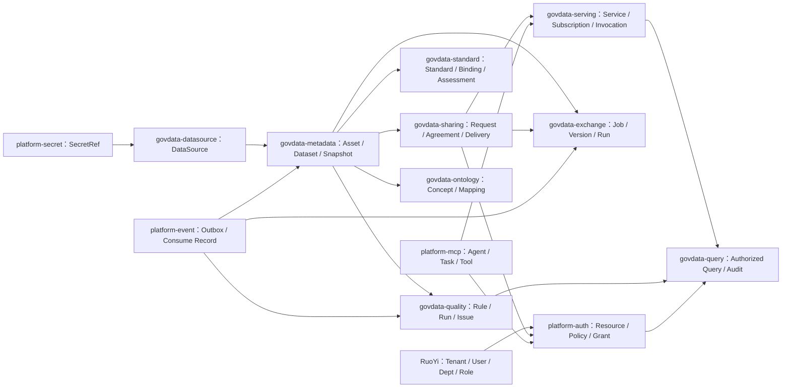

# 全模块数据库设计总览

- 状态：逻辑/物理设计基线 v1（待评审）
- 数据库：MySQL 8.0
- 字符集：`utf8mb4`
- 所有者：GovData Platform Team
- 最后更新：2026-08-02

## 设计范围

本设计只覆盖政务数据中台新增的 `platform-*` 与 `govdata-*` 表。下列能力直接复用
RuoYi-Vue-Plus，不建设第二套模型：

- 租户、用户、部门、角色、菜单：`sys_tenant`、`sys_user`、`sys_dept`、`sys_role`、
  `sys_user_role`、`sys_role_menu`、`sys_role_dept`、`sys_menu`。
- 登录客户端：`sys_client`。
- 人工审批：WarmFlow 表。
- 后台调度：Quartz JDBC JobStore 基础设施表；领域计划和运行记录仍由所属领域保存。
- 操作日志和登录日志：现有 `sys_oper_log`、`sys_logininfor`。

模块表设计分为：

- [平台通用能力](01-platform-tables.md)：授权、Secret、事件、Agent 与 MCP。
- [数据接入与目录](02-datasource-query-metadata-tables.md)：数据源、查询网关、元数据。
- [数据流通](03-exchange-sharing-serving-tables.md)：交换、共享、数据服务。
- [数据治理与语义](04-standard-quality-ontology-tables.md)：标准、质量、本体。

本版共设计 117 张新增表，其中 P0 81 张、P1 23 张、P2 13 张。这里的 P0 表示“对应模块
首次可用时必须建设”，不表示 111 张表需要在同一个迭代同时开发。

| 模块 | 表数量 |
|---|---:|
| platform-auth | 16 |
| platform-secret | 3 |
| platform-event | 3 |
| platform-mcp / Agent | 9 |
| govdata-datasource | 4 |
| govdata-query | 3 |
| govdata-metadata | 16 |
| govdata-exchange | 8 |
| govdata-sharing | 9 |
| govdata-serving | 9 |
| govdata-standard | 10 |
| govdata-quality | 13 |
| govdata-ontology | 14 |

`platform-auth` 的 16 张表是完整目标设计；已确认的第一版只执行其中 10 张 Human 主体核心表。
其余 6 张在 SERVICE、属性注册、Agent Delegation 或 BreakGlass 对应能力开发时再进入升级 SQL。
第一版同时必须建设 `govdata-query`，否则授权产生的行列、脱敏和限量 Obligation 没有统一执行点。

## 核心事实关系



箭头表示通过稳定契约、事件或稳定 ID 协作，不表示数据库外键或跨模块 JOIN。

## 建设阶段

- `P0`：对应模块首次可用必须建设。
- `P1`：生产化、闭环管理或模块间可靠协作必须建设。
- `P2`：前瞻能力启用时建设，当前保留稳定边界但不要求立即建表。

P2 表不是“可能永远不用”的占位表；只有开始对应功能开发时才进入升级 SQL。

## 公共字段模板

### 可编辑聚合表

```text
{domain}_id       bigint       PK，雪花 ID
tenant_id         varchar(20)  NOT NULL，地区租户
{domain}_code     varchar(100) NOT NULL，租户内稳定编码
status            varchar(32)  NOT NULL，稳定状态码
lock_version      int          NOT NULL DEFAULT 0，乐观锁
del_flag          char(1)      NOT NULL DEFAULT '0'
create_dept       bigint       NULL
create_by         bigint       NULL
create_time       datetime(3)  NOT NULL
update_by         bigint       NULL
update_time       datetime(3)  NOT NULL
```

租户内稳定业务编码唯一索引统一为 `(tenant_id, {domain}_code)`，归档或逻辑删除后也不得复用。
只有确实支持逻辑删除的可编辑聚合使用 `del_flag`；发布版本、运行、事件和审计表不逻辑删除。

### 不可变版本表

```text
version_id        bigint       PK
tenant_id         varchar(20)  NOT NULL
aggregate_id      bigint       NOT NULL
version_no        int          NOT NULL
version_status    varchar(32)  NOT NULL
content_hash      varchar(64)  NOT NULL
created_by        bigint       NULL
created_time      datetime(3)  NOT NULL
published_by      bigint       NULL
published_time    datetime(3)  NULL
```

唯一索引为 `(tenant_id, aggregate_id, version_no)`。发布后禁止更新定义内容；新变化创建新版本。

### 关系表

关系表使用独立雪花主键，至少包含 `tenant_id`、两端稳定 ID、关系类型和创建审计字段。
核心多对多关系必须建表，不使用逗号字符串或无法校验的 JSON。

### 运行、事件与审计表

运行和审计记录追加写，不包含 `del_flag`、`update_by`、`update_time`。字段按记录类别使用：

| 类别 | 必需字段 |
|---|---|
| 用户、SERVICE、Agent 发起的访问/决策 | `tenant_id`、`trace_id`、`actor_type`、`actor_id`、`occurred_time` |
| 调度或事件触发的运行 | 上述字段；`actor_type=SYSTEM/SERVICE`，并保存 `trigger_type`、`trigger_ref` |
| 系统健康采样 | `tenant_id`、`trace_id`（可空）、`actor_type=SYSTEM`、`actor_id`（可空）、采样时间 |
| 纯事件投递状态 | `event_id`、消费者/发布者、状态及各阶段时间；主体从事件信封追溯 |

按真实检索模式建立 `(tenant_id, occurred_time)`、`(tenant_id, resource_id, occurred_time)`、
`trace_id` 等索引。高增长日志按月归档；达到数据量阈值后再引入 MySQL 分区，不在第一版提前分区。

## 跨模块引用规则

- 不建立跨模块数据库外键，不跨模块 JOIN 业务表。
- 跨模块保存稳定 ID，并在必要处保存名称、编码等最小历史快照。
- 同一模块内的租户表关系必须使用 `(tenant_id, id)` 复合外键或等价数据库约束；被引用表补
  `UK(tenant_id, id)`。跨模块引用由 Application Service 通过契约验证目标存在、状态有效且
  `tenant_id` 一致，禁止只验证全局雪花 ID。
- Resource 是授权投影，领域表仍是业务事实来源。
- `secret_ref` 只引用 Secret，不保存密码、Token 或私钥明文。
- 外部系统 ID 使用映射表或 `external_*` 字段，不充当平台主键。
- 所有 JSON 字段必须有注册 Schema 或明确结构；核心关系、状态和检索字段不得藏入 JSON。

## 全局注册表

`000000` 是真实管理租户，不作为“全局”魔法值。需要同时支持平台内置和租户扩展的注册表使用：

```text
scope_type   GLOBAL / TENANT
scope_key    GLOBAL 或真实 tenant_id
```

唯一键为 `(scope_type, scope_key, stable_code)`。此类表不走普通租户插件，只能通过专用 Repository
查询 `GLOBAL + 当前 tenant_id`，租户定义只允许覆盖明确声明可覆盖的属性。当前适用表包括
`authz_attribute_schema`、`gd_quality_rule_template` 和 `platform_mcp_tool`。

## 发布冻结规则

版本主表进入 `PUBLISHED` 后，其组成子表也全部不可变，包括 Pipeline、FieldMapping、输入参数、
输出字段、查询定义、数据元、代码项、Concept、Property 和 Relation。应用层只能经聚合根发布服务
写入；Mapper 不对外暴露。DDL 通过版本外键和必要唯一/检查约束保证归属，集成测试验证发布后
任何新增、修改或删除都被拒绝；`content_hash` 覆盖父版本及全部子行规范化内容。

## 状态与时间

- 状态使用英文稳定 code，不使用中文或数字魔法值。
- 时间一律为 `datetime(3)`，Java 对应 `LocalDateTime`。
- 有效期使用 `effective_time`、`expire_time`；业务发生时间使用 `occurred_time`；
  创建审计使用 `create_time`。
- 发布版本状态统一优先使用 `DRAFT/REVIEWING/PUBLISHED/DEPRECATED/ARCHIVED`。

## DDL 落地要求

本文件及子文档通过评审后，才按模块生成 `script/sql/baseline` 和不可变的
`script/sql/upgrade/YYYYMMDD_NNN_description.sql`。DDL 必须补齐字段 COMMENT、索引名称、
初始化顺序、锁表风险、验证 SQL 和必要回滚说明。
